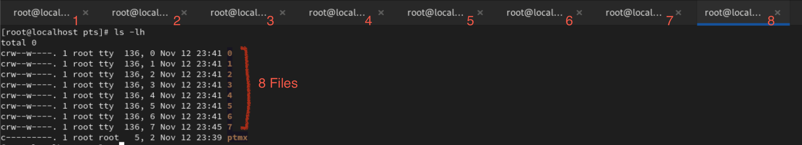

# Basic Commands
| Command                    | Use                                                                                                                                                                | Arguments                                                                                                                                                                                         |
| -------------------------- | ------------------------------------------------------------------------------------------------------------------------------------------------------------------ | ------------------------------------------------------------------------------------------------------------------------------------------------------------------------------------------------- |
| `ls`                       | Use to list file                                                                                                                                                   | `-a`: hidden file, `-l`: list format, `lt`: files sort by date and time (newest first, append `r` to reverse it)                                                                                  |
| `cd`                       | Navigate directories                                                                                                                                               |                                                                                                                                                                                                   |
| `pwd`                      | Present working directory                                                                                                                                          |                                                                                                                                                                                                   |
| `tty`                      | Shows the active terminal session user is on, if the user is on 6 th terminal this command with o/p `/dev/pts/6`. The o/p changes based on the terminal |                                                                                                                                                                                                   |
| `uptime`                   | Show current time, time for which the system is up, number of users logged and CPU load past 1, 5 and 15 min. Load ranges from 0-1                                 |                                                                                                                                                                                                   |
| `which`, `whereis`, `type` | Location of a command                                                                                                                                              |                                                                                                                                                                                                   |
| `uname`                    | Gets system information                                                                                                                                            | `-a`: other details, `-s`: kernel name, `-n`: node name, `-r`: kernel release, `-v`: kernel build date, ` -m`: hardware name, `-p`: processor type, `-i`: hardware platform, `-o `: OS name |
| `lscpu`                    | Getting CPU architecture and information                                                                                                                           |                                                                                                                                                                                                   |
| `info`, `pinfo`            | Both the commands are almost identical. Used to view doc like manual for commands.                                                                                 |                                                                                                                                                                                                   |
| `file`, `stat`             | Get information about Linux file types, *like regular files, directory, links etc*                                                                                 |                                                                                                                                                                                                   |
| `tar`                      | Archiving (combining) files and directory together                                                                                                                 | `-c`: Create a new archive, `-x`: Extract an archive, `-t`: list contents of a archive, `-z`: compress using `gzip`, `-p`: preserve permission when extracting                                    |
| `gzip`/`bzip`              | Compresses files                                                                                                                                                   | `-d`: decompress                                                                                                                                                                                  |

- Linux creates *pseudo* numbered device files when we open terminals. More number of terminals, more of these device files. These files are stored in `/dev/pts` on Linux *(and in `/dev` directory in Mac)*
  
- Reading the `uname` command: Kernel Name, Host Name, Kernel Release, Date and time of kernel build, machine hardware name, processor type, hardware platform, OS name
- `man` command is to get command manual. `man` command followed by a number take you to that section of the man page for the requested command. For example, `man 4 passwd` will open special file section of the `passwd` command manual page. Here is the section number table [[Man Page Sections]]
- `-k` option can be used to perform a keyword search *(if user is unable to recall a commands name, this is handy)*. Before doing so, user needs to run `mandb` command so to prepare a indexed DB.
- `/usr/shared/doc` stores documentation for commands

# File Management

- RHEL supports 7 type of files: 
  1. **Directory** - being with a `d` in `ls` output. Example, `drw-rw-rw-`
  2. **Regular** - may contain text and binary data, begins with `-` in `ls` output. Example, `-rwxrwxrwx`
  3. **Character special device** - Communicate with peripheral device. Beings with a `c` in `ls` output. Example, `crw-rw-rw-`
  4. **Block special device** - Communicate with peripheral device. Beings with a `b` in `ls` output. Example, `brw-rw-rw-`
  5. **Symbolic link** - Beings with a `l`  and an arrow pointing to the actual file in `ls` output. Example, `lrw-rw-rw-`
  6. **Named pipe** - Used for interprocess communication
  7. **Socket** - Used for interprocess communication

- Every hardware is has a associated file present in the `/dev` *(devices)* directory. Each hardware has a device driver, which resides in the kernel, which the kernel uses to communicated with the device. 
- Every device file is assigned a unique *major* number to identify the device driver to be used. Multiple instances of same device type be active on a system, to identify those, the OS assigns a *minor* number.
- `tar` is used to archive file, so it kinda concat multiple files and directory into a single file called *tarball*. `tar` command presereve directory structure. permissions and links.
- `gzip`/`bzip` command is used to compress a file. So usually we first archive a file (using `tar`) and then compress it using `gzip` or `bzip`. `bzip` ha a better compression ratio but is slower compared to `gzip`
- `zip` command combines archiving and compressing